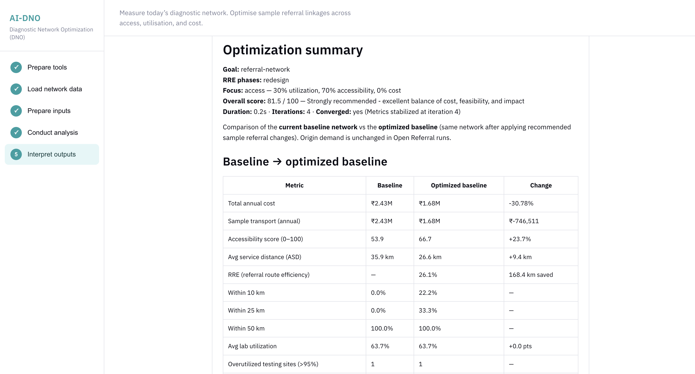
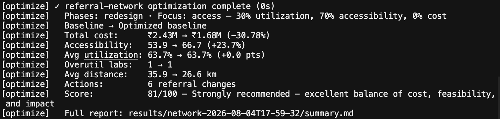

<h1 align="center">
  <a href="https://www.froncort.ai/" target="_blank">
    <picture>
      <source media="(prefers-color-scheme: dark)" srcset="ui/assets/froncort-banner-dark.png" />
      
    </picture>
  </a>
</h1>

<p align="center">
  <a href="LICENSE" target="_blank"></a>&nbsp;
  <picture></picture>&nbsp;
 
</p>

<p align="center">
  <a href="https://www.froncort.ai/" target="_blank"></a>&nbsp;
  <picture></picture>&nbsp;
  <picture></picture>&nbsp;
  <picture></picture>
</p>

<p align="center">
  <b>Open-source Diagnostic Network Optimization: see the network clearly, test better referral patterns, and make trade-offs visible.</b>
</p>

<p align="center">
  <a href="#five-minute-first-run"><b>Get Started</b></a>&nbsp;&nbsp;&nbsp;⚡&nbsp;&nbsp;&nbsp;
  <a href="docs/walkthrough.md"><b>Walkthrough</b></a>&nbsp;&nbsp;&nbsp;🧭&nbsp;&nbsp;&nbsp;
  <a href="docs/data-preparation.md"><b>Prepare Your Data</b></a>&nbsp;&nbsp;&nbsp;📋&nbsp;&nbsp;&nbsp;
  <a href="docs/algorithms.md"><b>Algorithms</b></a>&nbsp;&nbsp;&nbsp;🧮&nbsp;&nbsp;&nbsp;
  <a href="https://www.froncort.ai/ai-netra/dno" target="_blank"><b>AI-DNO Platform</b></a>
</p>

<br>
<br>

# 🧬 Welcome to AI-DNO Open Source

**AI-DNO Open Source** is the free, local-first edition of Froncort's **AI-NETRA Diagnostic Network Optimization (DNO)** engine. Use it to build a baseline of your current diagnostic network, assess access and capacity, and redesign sample referral linkages across **utilization**, **distance**, and **cost**.

It runs on your own computer through a **no-code visual UI**, a **CLI**, or a **Python API**. Your programme data never leaves your machine.

<p align="center">
  
</p>

<br>

## 🩺 DNO in Brief

**A diagnostic network** connects testing demand, referring health facilities, sample referral linkages (SRS), laboratories, diagnostic devices, and available capacity.

> Testing demand → referring facilities → sample referrals → testing sites → diagnostic capacity

**Diagnostic Network Optimization (DNO)** combines geospatial network analytics with programme constraints to measure the current network and compare possible improvements. It makes the trade-offs among access, utilization, and cost explicit, which a map or a facility list cannot do on its own.

The aim is not a mathematically "perfect" network. It is to give stakeholders clear evidence for choosing a feasible design that suits local priorities.

<br>

## 🔥 Why AI-DNO Is Different

- **🔒 Local-first and private**: Everything runs on `127.0.0.1`. There are no accounts and no cloud uploads, and results stay on your computer. After the first install it works fully offline.

- **🧑‍⚕️ Built for programme teams, not only data scientists**: A guided five-step UI covers preparing tools, loading data, preparing inputs, running the analysis, and interpreting outputs. No coding is needed.

- **⚖️ Trade-offs made explicit**: You choose a focus of **Access**, **Utilization**, **Cost**, or **Balanced** and see how each one changes the recommended referral pattern.

- **🧮 Real optimization, not heuristics**: Referral redesign is formulated as a **mixed-integer linear program (MILP)** and solved with **PuLP + CBC**, respecting laboratory capacity and optional administrative boundaries.

- **📊 Decision-ready outputs**: Each run produces a 3×3 scorecard (Financial · Programmatic · Impact), a plain-language decision brief, and CSV exports your team can open in any spreadsheet.

- **🔁 Reproducible by design**: Every run writes a manifest with content hashes, so the same inputs give the same, auditable result.

- **🧩 Three ways in**: Use the visual UI for programme teams, the CLI for analysts, or the Python API for integrators.

- **🌱 Open and extensible**: Apache 2.0 licensed. Read the algorithms, adapt them to your context, and contribute back.

<br>

## 🛠️ What's Included

- [x] Input validation with a readable validation report
- [x] Baseline development: utilization, accessibility, and cost KPIs
- [x] Open Referral (sample referral) redesign with an MILP solver
- [x] Four planning focuses: `access`, `util`, `cost`, `balanced`
- [x] Optimization within administrative boundaries (state/region or district)
- [x] Estimation of missing sample referral linkages (opt-in)
- [x] 3×3 scorecard and Markdown decision brief
- [x] CSV / JSON exports with a reproducible run manifest
- [x] No-code local UI with in-browser data editor and CSV import
- [x] CLI and Python API

<br>

<a id="ai-dno-platform"></a>

# ⚖️ Open Source vs AI-DNO Platform

Referral redesign is one part of a wider diagnostic network transformation programme. **[AI-DNO Platform](https://www.froncort.ai/ai-netra/dno)** by **Froncort.ai** builds on the same foundation and adds the full optimization engine for programme teams planning structural and service-delivery changes.

| Capability | What it does | Open Source<br><sub>Free</sub> | AI-DNO Platform<br><sub>Premium</sub> |
| ---------- | ------------ | :----------------------------: | :-----------------------------------: |
| **Develop baseline** | Measure today's network (utilization, accessibility, cost, and the 3×3 scorecard) before changing anything | ✅ | ✅ |
| **Open Referral redesign** | Optimize sample referral linkages (SRS) across access, device utilization, and transport cost | ✅ | ✅ |
| **Device relocation** | Move diagnostic devices between testing sites to balance utilization and reduce over-capacity labs | — | ✅ |
| **Capacity expansion** | Add devices, shifts, and new testing sites to close capacity gaps across the network | — | ✅ |
| **Test integration** | Activate overflow tests on co-located multi-test devices without new procurement | — | ✅ |
| **Route & hub design** | Model sample transport routes so hard-to-reach health facilities are served efficiently | — | ✅ |
| **Goal-driven optimization** | Capacity, utilization balance, coverage, demand projection, and budget-constrained scenarios | — | ✅ |
| **Network scenarios** | Compare baseline and optimized placements before you move a single device or referral | — | ✅ |
| **Grounded DNO agent** | Get AI recommendations tied to your project network, not generic templates | — | ✅ |
| **Programme collaboration** | Shared workspaces, team projects, maps, exports, and decision briefs | — | ✅ |

<p align="center">
  <a href="https://www.froncort.ai/ai-netra/dno#early-access" target="_blank"></a>&nbsp;
  <a href="mailto:info@froncort.ai" target="_blank"></a>
</p>

<br>
<br>

# 🚀 Getting Started

## 👥 Who Should Use Which Path?

| Audience | Recommended path |
| -------- | ---------------- |
| Programme and domain teams | Local visual UI: [Five-minute first run](#five-minute-first-run) |
| Data and modelling teams | UI editor + [docs/data-preparation.md](docs/data-preparation.md) |
| Analysts and repeatable workflows | CLI: [docs/walkthrough.md](docs/walkthrough.md#part-b-cli-walkthrough) |
| Software integrators | [Python API guide](docs/python-api.md) |

## ✅ Prerequisites

- **Python 3.10 or newer**
- **macOS, Linux, or Windows**
- **Internet** on first UI install (to download the optimization solver). Later runs work offline.
- Optimization uses **PuLP with bundled CBC**
- All files and results stay **local**. The UI is served from `http://127.0.0.1:8765` (or the next free port).
- In the UI, network paths must stay **inside the repository folder**

## ⚡ Five-Minute First Run

<a id="five-minute-first-run"></a>

### 🖱️ No-code UI (recommended)

```bash
git clone https://github.com/Froncort/AI-DNO-Optimisation-Algorithm.git
cd AI-DNO-Optimisation-Algorithm

./start-dno-ui.sh          # Linux
# start-dno-ui.bat         # Windows
# Start DNO UI.command     # macOS (double-click in Finder)
# or: python3 dno_ui.py
```

1. **Prepare tools**: click **Install DNO tools** and wait for **DNO tools ready**
2. **Load network data**: click **Use sample network**
3. **Prepare inputs**: review the tabs, then click **Save network inputs**
4. **Conduct analysis**: click **Run Open Referral optimisation**
5. **Interpret outputs**: review the scorecard, referral recommendations, and decision brief

Step 1 of the local UI also shows how this open-source workflow fits within the broader AI-DNO journey.

Full instructions: [docs/walkthrough.md](docs/walkthrough.md#part-a-ui-walkthrough).<br>
How to read results: [docs/walkthrough.md](docs/walkthrough.md#part-c-understanding-outputs).

### ⌨️ CLI

```bash
python3 -m venv .venv && source .venv/bin/activate   # Windows: .venv\Scripts\activate
pip install -e .

dno demo -o results/demo/
```

Open `results/demo/summary.md` and `results/demo/actions.csv` in any text editor or spreadsheet tool.

<p align="center">
  
</p>

<br>

## 🗺️ How the Tool Fits into a DNO Exercise

A full DNO exercise typically follows these programme stages:

1. **Define scope**: diseases, tests, geography, priority questions, and constraints (stakeholder-led).
2. **Prepare and validate data**: collate facility lists, demand, devices, and referral linkages.
3. **Develop a baseline**: measure the current network's utilization, access, and cost.
4. **Assess recommendations**: run Open Referral redesign and compare the baseline with an optimized referral pattern.
5. **Review feasibility and act**: select outputs with stakeholders; plan procurement, referral policy, and transport (programme-led).
6. **Monitor and update**: track performance and refresh the model when inputs change materially.

AI-DNO Open Source supports stages **2–4** analytically within its Open Referral scope. Scoping, implementation, and monitoring remain programme responsibilities. For end-to-end support across all six stages, see [AI-DNO Platform](#ai-dno-platform).

<br>
<br>

# 📥 Inputs at a Glance

| File | Role |
| ---- | ---- |
| `network.json` | **Required**: health facilities, testing sites, devices, annual demand, sample referral linkages |
| `network.catalogue.json` | **Optional**: device and test parameters; improves cost detail in reports |

**Two demand quantities** (keep them distinct):

| Concept | JSON field | Meaning |
| ------- | ---------- | ------- |
| Annual testing demand | `test_volumes` | Tests generated per year at each referring health facility |
| Annual referral volume | `referrals[].referral_count` | Samples sent along each facility → testing site linkage |

**Supported formats**

| Format | CLI | UI |
| ------ | --- | -- |
| `network.json` | Yes | Yes |
| CSV (per editor tab) | No direct upload | Yes, in **Prepare inputs** |
| Excel (.xlsx, .xls) | No | No (save each sheet as CSV first) |

Field-level guide and preparation checklist: [docs/data-preparation.md](docs/data-preparation.md).

<br>

## 🎯 Analysis Choices

<a id="analysis-choices"></a>

**Scenario** (`--goal`): `referral-network` only (aliases: `redesign`, `open-referral`, `open_referral`). The optimizer emits **REDESIGN** actions only. In reports these appear as **sample referral changes**, where a health facility is reassigned from one testing site to another.

**Focus** (`--focus`): sets the balance among access, utilization, and cost in the Open Referral objective.

| Focus | Emphasis |
| ----- | -------- |
| `access` | Minimize sample referral distance and improve accessibility (**default** when `--focus` is omitted) |
| `util` | Balance diagnostic device utilization across testing sites |
| `cost` | Reduce sample transport and network cost |
| `balanced` | Equal weight on access, utilization, and cost |

**Optional settings**

- **Optimize within administrative boundaries**: run redesign separately per state/region or district (`--partition-by-admin-area`, `--admin-area-level admin_area_1|admin_area_2`)
- **Estimate missing SRS**: create estimated referral linkages for facilities that have demand but no linkage (`--allow-synthetic-referrals`; review these before making decisions)

<br>

## 📤 Outputs and How to Read Them

`-o <dir>/` writes a result bundle locally. No database is used.

| File | Contents |
| ---- | -------- |
| `summary.md` | Decision brief: baseline vs optimized baseline, 3×3 scorecard |
| `actions.md` / `actions.csv` | Sample referral redesign recommendations |
| `metrics.csv` | Baseline and optimized metrics |
| `validation-report.md` | Input validation findings |
| `result.json` | Full solver payload |
| `result-brief.json` | Compact run metadata and result hash |
| `baseline.json` | Headline KPIs when using `--baseline-only -o` |
| `baseline-summary.md` | Readable summary when using `--baseline-only -o` |
| `run-manifest.json` | Artifact list and content hash |

**Baseline** is the network as submitted. **Optimized baseline** is the same demand and installed capacity after applying the recommended referral changes. It is not a separate saved programme scenario file.

The **3×3 scorecard** summarizes the Financial, Programmatic, and Impact dimensions. Read it together with `metrics.csv`, the action list, and a local feasibility review. It is not a standalone decision rule.

Detailed interpretation: [docs/walkthrough.md](docs/walkthrough.md#part-c-understanding-outputs).

<br>

## 🏗️ Using Your Own Network

1. Copy `samples/demo/` to a new folder, or run `dno init ./my-network --goal referral-network` for a skeleton.
2. Map programme data into `network.json` (and the optional catalogue) per [docs/data-preparation.md](docs/data-preparation.md).
3. Validate: `dno optimize -n ./my-network/network.json --check-only`
4. Develop a baseline: `dno optimize -n ./my-network/network.json --baseline-only -o results/baseline/`
5. Optimize: `dno optimize -n ./my-network/network.json -c ./my-network/network.catalogue.json -g referral-network -o results/my-run/`
6. Review the outputs with stakeholders.

> [!NOTE]
> Saving through the UI overwrites the selected JSON files and creates timestamped `.bak` backups. Copy the sample folder first if you need to keep the committed demo unchanged.

Full CLI commands: [docs/walkthrough.md](docs/walkthrough.md#part-b-cli-walkthrough).

<br>
<br>

# 🧑‍💻 Developer Reference

## ⌨️ CLI Reference

| Command | Purpose |
| ------- | ------- |
| `dno demo -o results/` | Run the bundled sample network |
| `dno optimize -n network.json [-c catalogue.json] -o results/` | Open Referral optimization |
| `dno init ./my-network` | JSON skeleton for your input |

**Common flags for `dno optimize`**

| Flag | Purpose |
| ---- | ------- |
| `-g referral-network` | Scenario (default) |
| `--focus access\|util\|cost\|balanced` | Objective emphasis |
| `--check-only` | Validate input only |
| `--baseline-only` | Baseline metrics only |
| `--partition-by-admin-area` | Optimize per admin boundary |
| `--admin-area-level admin_area_1\|admin_area_2` | Boundary level |
| `--allow-synthetic-referrals` | Allow estimated missing linkages |
| `-q` | Minimal terminal output |
| `-v` | Verbose solver logs |

## 🐍 Python API

<a id="python-api"></a>

```python
from dno_core import optimize, load_network_json, evaluate_baseline_rich, OssGoal

state = load_network_json(
    "samples/demo/network.json",
    goal_preset="open_referral",
)
rich = evaluate_baseline_rich(state)
result = optimize(state, goal=OssGoal(preset="open_referral"))
print(result.to_summary())
```

The Python API returns an `OptimizationResult`. Use `dump_result_json` when you need the same machine-readable structure the CLI writes. See the [Python API guide](docs/python-api.md) for integration details and result formats.

## 📚 Documentation Map

| Document | For |
| -------- | --- |
| [docs/walkthrough.md](docs/walkthrough.md) | Complete UI and CLI operation, output interpretation, troubleshooting |
| [docs/data-preparation.md](docs/data-preparation.md) | Input contract and preparation checklist |
| [docs/python-api.md](docs/python-api.md) | Python integration and machine-readable results |
| [docs/algorithms.md](docs/algorithms.md) | MILP redesign, constraints, and 3×3 scoring (analysts) |
| [samples/demo/README.md](samples/demo/README.md) | Synthetic sample network for learning |

## 📁 Repository Layout

```text
src/dno_core/           Open Referral optimization kernel
docs/                   User guides and technical references
samples/demo/           Synthetic sample network
dno_ui.py + ui/         Local no-code UI
results/                Local run outputs (gitignored)
tests/                  Package boundary checks
```

<br>
<br>

# 🧭 Responsible Interpretation

Recommendations from AI-DNO Open Source are analytical evidence for stakeholder review. They are not automatic implementation instructions.

Before acting on outputs, confirm data quality, scope assumptions, policy constraints, terrain and transport feasibility, staffing and sustainability, and alignment with national programme strategy. A recommendation that looks optimal in the model may be impractical on the ground unless local context is applied.

<br>
<br>

# 🌐 Contributions

We welcome contributions of every size, from fixing a typo in the docs to improving the solver. Contributions are licensed under the Apache License 2.0. See [CONTRIBUTING.md](CONTRIBUTING.md). Community expectations are in the [Code of Conduct](CODE_OF_CONDUCT.md). Report security issues privately using [SECURITY.md](SECURITY.md).

1. **Fork** the repository and create a feature branch (`git checkout -b feature/my-improvement`).
2. **Open a pull request** describing what changed and why.
3. **Froncort members review** the pull request and merge it into `main`.

Found a bug or have an idea? [Open an issue](https://github.com/Froncort/AI-DNO-Optimisation-Algorithm/issues).

<br>
<br>

# 💭 Join Our Community

<p align="center">
  <a href="https://www.froncort.ai/" target="_blank"></a>&nbsp;
  <a href="https://www.linkedin.com/company/froncortai/" target="_blank"></a>&nbsp;
  <a href="https://github.com/Froncort" target="_blank"></a>
</p>

<br>
<br>

# 📜 License

Copyright 2026 Froncort.

**AI-DNO Open Source** is released under the [Apache License, Version 2.0](LICENSE). See [NOTICE](NOTICE) for attribution.

**AI-DNO Platform** (device relocation, capacity expansion, test integration, route and hub design, goal-driven scenarios, collaboration, and the grounded DNO agent) is a separate commercial product from Froncort.ai and is **not** part of this repository. See the [feature comparison](#ai-dno-platform) or [contact Froncort](mailto:info@froncort.ai) for access.

<br>

<p align="center">
  <a href="https://www.froncort.ai/" target="_blank">
    
  </a>
  <br>
  <sub>Part of the <a href="https://www.froncort.ai/">AI-NETRA</a> family of public-health intelligence tools.</sub>
</p>
