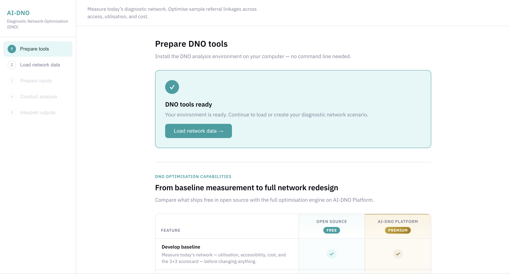
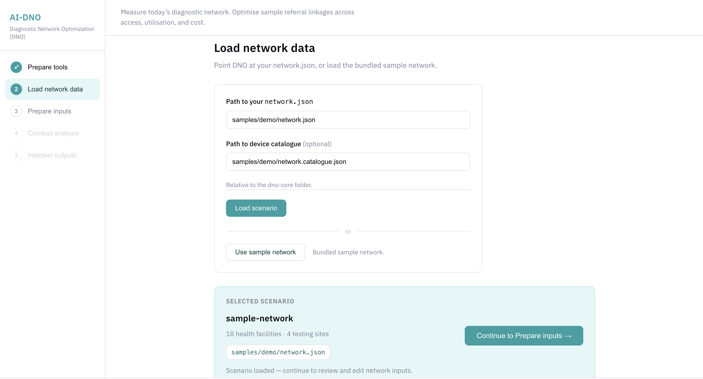
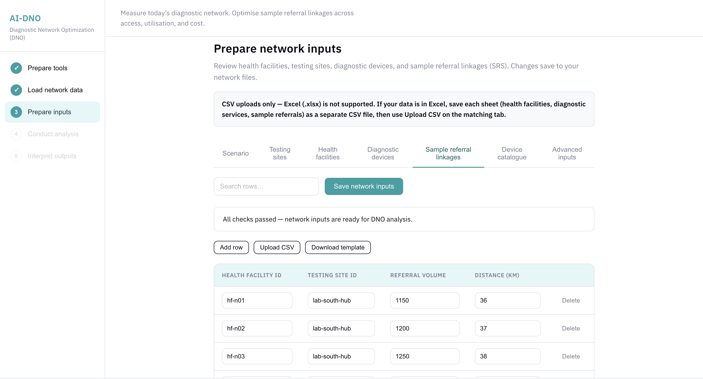
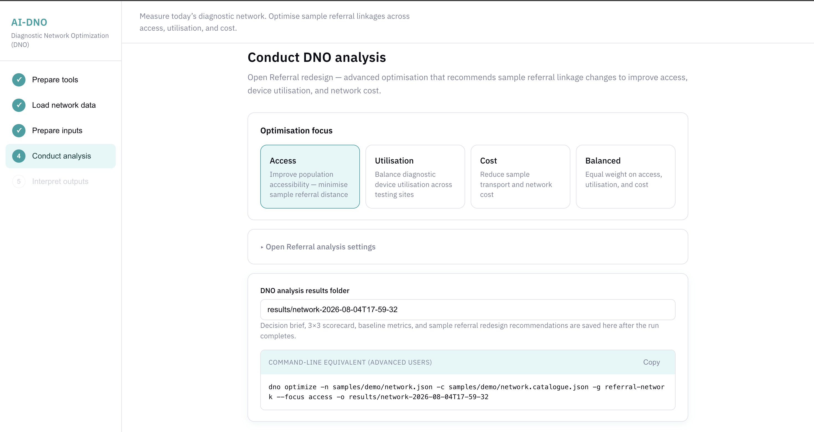
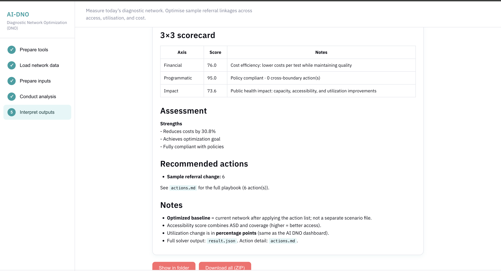

# AI-DNO Open Source Walkthrough Guide

This guide walks you through a complete Open Referral analysis using the bundled **synthetic sample network**. After completing it, you will know how to validate inputs, develop a baseline, run optimization, and interpret the resulting files — then repeat the workflow with your own programme data.

> **About this edition:** This walkthrough covers AI-DNO Open Source: local baseline assessment and Open Referral redesign. AI-DNO Platform extends this foundation to device placement, capacity expansion, route and hub design, programme scenarios, collaboration, and grounded AI. See the [README](../README.md#ai-dno-platform) or visit the [AI-NETRA website](https://www.froncort.ai/ai-netra) for additional context.

**Two routes**

| Route | Best for |
| ----- | -------- |
| [Part A — UI walkthrough](#part-a-ui-walkthrough) | Programme teams and first-time users |
| [Part B — CLI walkthrough](#part-b-cli-walkthrough) | Repeatable runs, scripting, and advanced analysts |

The sample under `samples/demo/` is **synthetic learning data only**. It demonstrates baseline issues and the Open Referral workflow; it does not represent a real country network. The number of accepted redesign recommendations can vary by focus and solver safeguards.

---

## Before you start

Confirm the following:

- [ ] Python **3.10 or newer** is installed
- [ ] You are working inside the **`dno-core`** folder
- [ ] **Internet** is available for first-time UI setup (solver download)
- [ ] A writable **`results/`** folder exists or will be created automatically
- [ ] For programme data later: copy `samples/demo/` before editing, because saving overwrites JSON files

---

## Part A: UI walkthrough

### Launch the local UI

**Linux**

```bash
cd dno-core
./start-dno-ui.sh
```

**Windows**

```bat
cd dno-core
start-dno-ui.bat
```

**macOS**

Double-click `Start DNO UI.command`, or:

```bash
cd dno-core
python3 dno_ui.py
```

The browser opens automatically at `http://127.0.0.1:8765/`. If port 8765 is busy, the server uses the next available port (8766–8774) and prints the URL in the terminal.

To stop the server, press **Ctrl+C** in the terminal where the UI is running. Closing the browser tab alone does not stop the server.

---

### Step 1 — Prepare tools

1. Open the UI and review the **Environment checklist**:
   - Your computer
   - Python runtime
   - DNO workspace
   - DNO optimiser
   - Optimisation solver
2. Click **Install DNO tools** (the button may show **Install everything** after the page loads).
3. Watch the **Activity log** at the bottom of the screen for installation progress.
4. When ready, the page shows **DNO tools ready** and **Load network data →**.

**First run:** internet is required to download the optimization solver. After installation, analyses run offline.

**Troubleshooting:** expand **Having issues?** for **Repair / reinstall** or **Remove environment**.


*Environment checks complete. Continue to Load network data.*

---

### Step 2 — Load network data

1. Click **Load network data** in the sidebar (or **Load network data →** from Step 1).
2. Click **Use sample network** — the primary tutorial path.
3. Confirm the **Selected scenario** card shows:
   - Scenario name (e.g. `sample-network`)
   - Counts such as **18 health facilities · 4 testing sites**
   - Path `samples/demo/network.json` (relative to `dno-core`)
4. Click **Continue to Prepare inputs →**.

**Alternative:** enter paths manually:

| Field | Example |
| ----- | ------- |
| Path to your `network.json` | `my-scenario/network.json` |
| Path to device catalogue (optional) | `my-scenario/network.catalogue.json` |

Paths must stay **inside the `dno-core` folder**. Absolute paths outside the repository are rejected.


*Bundled sample selected. Verify facility and testing-site counts before continuing.*

---

### Step 3 — Prepare network inputs

Review and edit network data in the tabbed editor. Work through tabs in this domain order:

| Tab | Contents |
| --- | -------- |
| **Scenario** | Scenario ID and file path |
| **Health facilities** | Referring sites, coordinates, admin areas, **annual testing demand** |
| **Testing sites** | Laboratories and testing locations |
| **Diagnostic devices** | Device assignment to testing sites, shifts, capacity |
| **Sample referral linkages** | Current facility → testing site linkages and **referral volume** |
| **Device catalogue** | Optional device/test economics |
| **Advanced inputs** | Experienced users only — raw JSON fields |

**Toolbar actions on each table tab**

- **Add row** — insert a new record
- **Upload CSV** — import rows (replaces existing rows on that tab)
- **Download template** — CSV column headers for that tab
- **Search rows…** — filter visible rows
- **Save network inputs** — write changes to disk (creates a timestamped `.bak` backup)

**CSV column headers (by tab)**

| Tab | CSV columns |
| --- | ----------- |
| Health facilities | ID, Name, Latitude, Longitude, Admin area 1, Admin area 2, Annual testing demand |
| Testing sites | ID, Name, Latitude, Longitude, Admin area 1, Admin area 2 |
| Diagnostic devices | Device ID, Health facility ID (must be a testing site ID), Device type, Max shifts, Max tests/shift |
| Sample referral linkages | Health facility ID, Testing site ID, Referral volume, Distance (km) |
| Device catalogue | Device type ID, Name, Test type ID, Max tests/shift, Max shifts, Cost/test |

**Excel is not supported.** Save each workbook sheet as a separate CSV file before upload.

**Validation banner**

- Green: **All checks passed — network inputs are ready for DNO analysis.**
- Red: errors with field paths — fix before saving or continuing
- Yellow: warnings — you may continue, but review before analysis

Common validation errors:

- Device assigned to a health facility instead of a testing site
- Demand listed for a facility with no sample referral linkage
- More than one referral linkage per health facility (one testing site per facility is supported)
- Unknown or duplicate IDs

When validation passes, click **Continue to Conduct analysis →** (saves inputs if not yet saved).


*Referral linkages reviewed; validation passed.*

Full field reference: [data-preparation.md](data-preparation.md).

---

### Step 4 — Conduct DNO analysis

#### Optimisation focus

Choose one focus card (**Access** is selected by default):

| Focus | Planning intent |
| ----- | --------------- |
| **Access** | Improve population accessibility — minimise sample referral distance |
| **Utilisation** | Balance diagnostic device utilisation across testing sites |
| **Cost** | Reduce sample transport and network cost |
| **Balanced** | Equal weight on access, utilisation, and cost |

#### Open Referral analysis settings (expand to view)

| Setting | Purpose |
| ------- | ------- |
| **Optimise within administrative boundaries** | Run redesign separately per state/region or district |
| **Boundary level** | State / region (Admin area 1) or District (Admin area 2) |
| **Estimate missing SRS for facilities with demand** | Create estimated linkages before optimization — review carefully |
| **Minimise log output** | Hide detailed solver progress |
| **Verbose troubleshooting logs** | Show DEBUG diagnostics (use when a run fails) |
| **DNO analysis results folder** | Where output files are written (default: `results/<network>-<timestamp>/`) |

The **Command-line equivalent** panel shows the matching `dno optimize …` command. Use **Copy** to transfer settings to the CLI.


*Choose an optimization focus and review the output folder and command preview.*

#### Recommended run sequence

1. **Validate network inputs** — writes `validation-report.md` without running the solver
2. **Develop baseline only** — current-state metrics (`baseline.json`, `baseline-summary.md`) without optimization
3. **Run Open Referral optimisation** — full redesign analysis

During a run, open the **Activity log** in the browser UI (bottom panel — not the terminal where you started the server). It shows the equivalent `dno optimize …` command, solver progress, and **`Completed successfully.`** when the run finishes. Use **Cancel** to stop a running job.

When the run finishes, the UI navigates to **Interpret outputs**.

---

### Step 5 — Interpret DNO outputs

Review results in this order:

1. **Validation report** — confirm that the submitted inputs passed validation.
2. **Baseline versus optimized baseline** — compare cost, access, utilization, and referral efficiency.
3. **3×3 scorecard** — read the Financial, Programmatic, and Impact dimensions together.
4. **Sample referral redesign recommendations** — review each proposed facility-to-testing-site change.
5. **Decision brief** — read the narrative summary and key assumptions.

The **Decision brief** and **Baseline metrics** tabs present complementary views of the same run. Use the brief for stakeholder review and the metrics tab for detailed values.

**Export actions**

| Button | Action |
| ------ | ------ |
| **Download CSV** | Referral recommendations as `actions.csv` |
| **Show in folder** | Open the results directory in your file manager |
| **Download all (ZIP)** | Archive the full result bundle |

**Previous DNO analysis runs** lists earlier folders under `results/` — click to reopen.

**Zero recommendations:** the run may still succeed. It can mean no feasible reassignment met the model's improvement thresholds, not necessarily an error.


*Optimization summary and baseline-versus-optimized comparison.*


*Scorecard, assessment, recommended actions, and result exports.*

How to read each term: [Part C — Understanding outputs](#part-c-understanding-outputs).

---

### Repeat with programme data

1. Copy `samples/demo/` to a new folder (e.g. `my-programme/`) — do not edit the committed sample in place.
2. Replace IDs, coordinates, demand, devices, and referral linkages with programme data.
3. Use **Download template** on each editor tab, or prepare JSON directly per [data-preparation.md](data-preparation.md).
4. Confirm each device’s `facility_id` points to a **testing site**, not a referring health facility.
5. Confirm one referral linkage per health facility with demand.
6. **Validate network inputs** before optimization.
7. Agree focus and boundary settings with stakeholders.
8. Preserve each run folder under `results/` for audit and comparison.

---

## Part B: CLI walkthrough

### Install and verify

**macOS / Linux**

```bash
cd dno-core
python3 -m venv .venv
source .venv/bin/activate
pip install -e .
dno --help
```

**Windows**

```bat
cd dno-core
py -3.12 -m venv .venv
.venv\Scripts\activate
pip install -e .
dno --help
```

Expected command families: `demo`, `init`, `optimize`.

---

### Run the bundled sample

```bash
dno demo -o results/demo/
```

On success, the terminal prints a concise optimization summary:


*Example terminal summary showing baseline-to-optimized changes, recommended referral actions, and the saved report path.*

The same run writes:

```text
results/demo/
├── summary.md
├── actions.md
├── actions.csv
├── metrics.csv
├── validation-report.md
├── result.json
├── result-brief.json
└── run-manifest.json
```

Open `results/demo/summary.md` in a text editor to read the decision brief.

---

### Safe analysis sequence

```bash
# 1. Validate only
dno optimize -n samples/demo/network.json \
  -c samples/demo/network.catalogue.json \
  --check-only

# 2. Baseline only
dno optimize -n samples/demo/network.json \
  -c samples/demo/network.catalogue.json \
  --baseline-only -o results/baseline/

# 3. Full Open Referral optimization
dno optimize -n samples/demo/network.json \
  -c samples/demo/network.catalogue.json \
  -g referral-network \
  --focus access \
  -o results/demo-run/
```

Exit code **0** means success; **1** means validation failure or solver error (message on stderr).

---

### Analysis settings (CLI)

**Focus variants**

```bash
dno optimize -n samples/demo/network.json -c samples/demo/network.catalogue.json \
  -g referral-network --focus access -o results/access/

dno optimize -n samples/demo/network.json -c samples/demo/network.catalogue.json \
  -g referral-network --focus util -o results/util/

dno optimize -n samples/demo/network.json -c samples/demo/network.catalogue.json \
  -g referral-network --focus cost -o results/cost/

dno optimize -n samples/demo/network.json -c samples/demo/network.catalogue.json \
  -g referral-network --focus balanced -o results/balanced/
```

**Administrative partition**

```bash
# By state / region
dno optimize -n samples/demo/network.json -c samples/demo/network.catalogue.json \
  -g referral-network --partition-by-admin-area \
  --admin-area-level admin_area_1 -o results/partition-a1/

# By district
dno optimize -n samples/demo/network.json -c samples/demo/network.catalogue.json \
  -g referral-network --partition-by-admin-area \
  --admin-area-level admin_area_2 -o results/partition-a2/
```

**Estimated missing referral linkages**

```bash
dno optimize -n samples/demo/network.json -c samples/demo/network.catalogue.json \
  -g referral-network --allow-synthetic-referrals -o results/synthetic/
```

Review estimated linkages before using results in programme decisions.

**Log verbosity**

```bash
dno optimize -n samples/demo/network.json -g referral-network -o results/ -q   # quiet
dno optimize -n samples/demo/network.json -g referral-network -o results/ -v   # verbose
```

---

### Start with programme data

```bash
dno init ./my-network --goal referral-network
# Edit ./my-network/network.json with real programme data

dno optimize -n ./my-network/network.json --check-only

dno optimize -n ./my-network/network.json \
  -c ./my-network/network.catalogue.json \
  -g referral-network -o results/my-network/
```

If `-c` is omitted, the CLI looks for `{network_stem}.catalogue.json` beside the network file, then `catalogue.json` in the same directory.

`dno init` produces a **skeleton** — replace every placeholder with real data before analysis.

---

### Interpret command results

Follow the same review sequence as the UI:

1. Read `validation-report.md` if validation was run
2. Read `baseline-summary.md` / `baseline.json` for baseline-only runs
3. Read `summary.md` for the decision brief and 3×3 scorecard
4. Review `actions.csv` for referral changes
5. Use `metrics.csv` for numeric baseline vs optimized comparison

Programme teams: prioritize `summary.md`, `actions.csv`, and `metrics.csv`.  
Integrators: use `result.json` and the [Python API example in the README](../README.md#python-api).

---

## Part C: Understanding outputs

| Term | Meaning |
| ---- | ------- |
| **Baseline / current state** | The network exactly as described in your submitted `network.json` |
| **Optimized baseline** | The same demand and installed capacity after applying recommended referral changes — not a separate scenario file on disk |
| **Average service distance (ASD)** | Volume-weighted average distance from health facilities to assigned testing sites; lower is generally preferable, subject to capacity |
| **Utilization** | Demand served relative to effective testing capacity; over-utilized and under-utilized sites both warrant review |
| **Cost** | Modelled annual network cost (transport and related parameters where available) — indicative, not a final budget |
| **Referral route efficiency (RRE)** | Improvement in total sample transport distance between baseline and optimized referral pattern |
| **3×3 scorecard** | Summary across Financial, Programmatic, and Impact dimensions — read alongside `metrics.csv` and the action list |
| **Sample referral change** | A REDESIGN recommendation: reassign a health facility from one testing site to another |
| **Validation warnings** | Data quality notes that should accompany any exported brief |
| **Synthetic referrals** | Estimated linkages created when `--allow-synthetic-referrals` is enabled — treat as provisional |

**Result bundle files**

| File | Use |
| ---- | --- |
| `summary.md` | Stakeholder decision brief |
| `actions.csv` | Referral changes for operational review |
| `metrics.csv` | Spreadsheet-friendly baseline vs optimized metrics |
| `validation-report.md` | Input check audit trail |
| `result.json` | Full machine-readable solver output |
| `run-manifest.json` | List of artifacts and content hash |

---

## Part D: Troubleshooting and FAQ

| Issue | Remedy |
| ----- | ------ |
| Python below 3.10 | Install Python 3.10+ from [python.org](https://www.python.org/downloads/) |
| DNO tools not ready after install | Use **Repair / reinstall**; check Activity log for pip or solver errors |
| Port 8765 busy | Server auto-tries 8766–8774; use the URL printed in the terminal |
| Path must stay inside dno-core | Use relative paths within the repository (e.g. `my-scenario/network.json`) |
| Excel upload rejected | Save each sheet as CSV (File → Save As → CSV) |
| Unknown or duplicate device ID | Ensure unique `device_id` values in the devices tab |
| Device assigned to health facility | Each device `facility_id` must match a **testing site** ID in `labs[]` |
| Demand without referral linkage | Add a referral row or enable **Estimate missing SRS** (review results) |
| Multiple referrals per facility | One active testing-site linkage per health facility in the current model |
| No referral recommendations | May indicate no beneficial feasible changes; review `summary.md` and validation |
| Analysis failed | Enable **Verbose troubleshooting logs** or CLI `-v`; preserve validation report and activity log |
| Difference: DNO vs mapping vs route optimization | Mapping visualizes sites; DNO optimizes referral assignment; route optimization schedules vehicles — this package covers Open Referral redesign only |

---

## Related documentation

- [README](../README.md) — overview, scope, and quick start
- [data-preparation.md](data-preparation.md) — input field reference
- [python-api.md](python-api.md) — Python integration and result serialization
- [algorithms.md](algorithms.md) — optimization method and scoring
- [samples/demo/README.md](../samples/demo/README.md) — what the synthetic sample demonstrates
